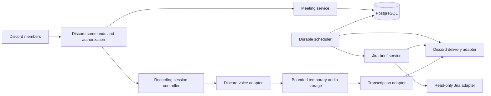

# Proposed architecture

**Status:** overall design proposal. The configuration, basic Discord commands, PostgreSQL lifecycle, and initial migration are implemented; feature services remain planned. Record provider and library selections in architecture decision records before depending on them.

## System shape

Start with one deployable asynchronous Python application and PostgreSQL. Use bounded background workers within the application rather than introducing a separate message broker initially. One active scheduler instance is the initial deployment assumption; multiple replicas require database leases or equivalent coordination first.

## Responsibilities

- **Discord adapter:** interaction parsing, permission checks, acknowledgements, and message delivery. No scheduling or Jira query logic in command handlers.
- **Meeting service:** schedule validation, reminder planning, cancellation, and recording authorization state.
- **Scheduler:** claim due jobs, track attempts, retry transient failures, and record delivery outcomes. Reconstruct work from durable state after restart.
- **Jira adapter and brief service:** perform a configured read-only query with pagination; normalize results and render a deterministic brief. Treat issue content as untrusted text and suppress unwanted mentions.
- **Recording controller and voice adapter:** explicit session lifecycle, participant notice, authorized start/stop, disconnect handling, and bounded audio capture. Library support for receive/decryption must be proven against current Discord behavior.
- **Transcription adapter:** process audio through an approved provider, expose progress/failure, and return transcript artifacts. Speaker attribution must remain unknown unless the capture method supports it reliably.
- **Persistence:** migrations, transactional state updates, delivery identities, retention metadata, and scoped guild configuration.

Suggested eventual package boundaries are `config`, `domain`, `services`, `adapters`, `storage`, and `workers`. Add them when implementation needs them; avoid empty scaffolding.

## Durable records

- Guild configuration: allowed operators, destination channels, time zone, brief schedule, Jira project/filter and status mapping.
- Meeting: guild, channels, UTC start, original time zone, reminder offsets, organizer, and lifecycle state.
- Job: stable identity, due time, state, attempt count, retry time, and delivery receipt when available.
- Recording session: meeting, authorization/notice metadata, lifecycle state, bounded storage reference, and deletion deadline.
- Transcript artifact: session, provider job reference if applicable, delivery receipt, retention deadline, and failure category. Avoid retaining transcript content in the database by default.

Use foreign keys and uniqueness constraints for scope and job identities. Decide whether Jira credentials are team-wide or per-guild before implementing credential lookup. Never persist credentials in ordinary configuration rows.

## Scheduling and delivery

Store UTC-aware timestamps and calculate daily brief times using the guild's IANA zone. Define and test ambiguous/nonexistent daylight saving times. Proposed defaults: send a missed brief once on same-day recovery; skip reminder offsets already past when recovering, while retaining future reminders. Confirm these policies before implementation.

Use transactions to claim jobs and finite retries for transient failures. Discord delivery and database updates cannot be atomic: a crash after sending can cause a duplicate. Retain message receipts, reconcile when possible, and document the remaining duplicate window rather than promising exactly-once delivery.

## Recording lifecycle

Use explicit states such as `requested`, `recording`, `transcribing`, `delivering`, `completed`, `failed`, and `cancelled`. Define allowed transitions and cleanup for each. Notify the channel before capture and handle late arrivals according to the approved consent policy. If notice or authorization cannot be maintained, stop capture. Bound recording time, file size, concurrent sessions, and provider usage.

Delete temporary audio after successful processing or cancellation, with bounded retention for failed jobs only if approved. Transcript messages and attachments have separate deletion requirements; deleting local files does not delete Discord copies. Treat already-published material and provider retention as part of the data lifecycle.

## Operations and testing

Validate configuration before connecting. Use health checks for database connectivity and worker progress, plus structured logs for job outcomes without sensitive content. On shutdown, stop accepting recording sessions, release voice connections, persist recoverable job state, close clients, and clean temporary files.

Unit tests use fake clocks and fake adapters. Integration tests verify PostgreSQL constraints and adapter response handling. Controlled live smoke tests separately verify reminders, a read-only Jira query and brief, and synthetic-audio capture/transcription in a private server. CI must not depend on live Discord meetings or production credentials.
