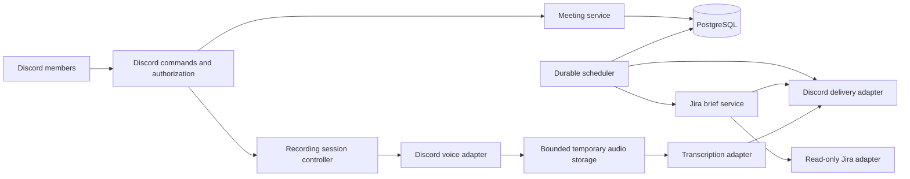

# Architecture

**Status:** Configuration, basic Discord commands, the meeting service, durable reminder jobs, the read-only Jira brief, per-guild settings, startup failure categories, and the single-process scheduler are implemented on `main`. Hosted CI passed for [PR #9](https://github.com/RileyHop1/JDR_Team_Management_bot/pull/9), [PR #15](https://github.com/RileyHop1/JDR_Team_Management_bot/pull/15), [PR #16](https://github.com/RileyHop1/JDR_Team_Management_bot/pull/16), [PR #17](https://github.com/RileyHop1/JDR_Team_Management_bot/pull/17), and [PR #18](https://github.com/RileyHop1/JDR_Team_Management_bot/pull/18). Reminder policy is provisional in [decision 0002](decisions/0002-meeting-reminders.md). Brief policy is provisional in [decision 0003](decisions/0003-jira-morning-brief.md). Guild settings are provisional in [decision 0004](decisions/0004-guild-configuration.md). Startup categories are accepted in [decision 0005](decisions/0005-startup-failures.md). Recording and transcription remain planned: [PR #4](https://github.com/RileyHop1/JDR_Team_Management_bot/pull/4) merged the planning document only, and implementation has not started. Live Discord and Jira smoke checks have not been run. The current record is [implementation issues](ISSUES.md). Record provider and library selections in architecture decision records before depending on them.

## System shape

Start with one deployable asynchronous Python application and PostgreSQL. Use bounded background workers within the application rather than introducing a separate message broker initially. One active scheduler instance is the initial deployment assumption; multiple replicas require database leases or equivalent coordination first.

## Responsibilities

- **Discord adapter:** interaction parsing, permission checks, acknowledgements, and message delivery. No scheduling or Jira query logic in command handlers.
- **Meeting service:** schedule validation, reminder planning, cancellation, and recording authorization state.
- **Scheduler:** claim due jobs, track attempts, retry transient failures, and record delivery outcomes. Reconstruct work from durable state after restart.
- **Jira adapter and brief service:** perform a configured read-only query with pagination; normalize results and render a deterministic brief. Treat issue content as untrusted text and suppress unwanted mentions.
- **Recording controller and voice adapter:** explicit session lifecycle, participant notice, authorized start/stop, disconnect handling, and bounded audio capture. Library support for receive/decryption must be proven against current Discord behavior.
- **Transcription adapter:** process audio through an approved provider, expose progress/failure, and return transcript artifacts. Speaker attribution must remain unknown unless the capture method supports it reliably.
- **Persistence:** migrations, transactional state updates, delivery identities, retention metadata, and scoped guild configuration.

Suggested eventual package boundaries are `config`, `domain`, `services`, `adapters`, `storage`, and `workers`. Add them when implementation needs them; avoid empty scaffolding.

## Durable records

- Guild configuration: destination channels, IANA time zone, and brief local time are stored as nullable columns. Allowed operators and the Jira project, filter, and status mapping stay in the process environment until the team confirms otherwise. See [decision 0004](decisions/0004-guild-configuration.md). Credentials are not stored in the row.
- Meeting: guild, channels, UTC start, original time zone, reminder offsets, organizer, and lifecycle state.
- Job: stable identity, due time, state, attempt count, retry time, and delivery receipt when available.
- Recording session: meeting, authorization/notice metadata, lifecycle state, bounded storage reference, and deletion deadline.
- Transcript artifact: session, provider job reference if applicable, delivery receipt, retention deadline, and failure category. Avoid retaining transcript content in the database by default.

Use foreign keys and uniqueness constraints for scope and job identities. Jira credentials are process-wide environment settings, as recorded in [decision 0003](decisions/0003-jira-morning-brief.md). Never persist credentials in ordinary configuration rows.

## Scheduling and delivery

Store UTC-aware timestamps and calculate daily brief times using the guild's IANA zone. Define and test ambiguous/nonexistent daylight saving times. Reminder recovery is specified in [decision 0002](decisions/0002-meeting-reminders.md) and still needs team confirmation: skip offsets outside the 60-second grace, keep future reminders, and do not resend a reminder whose receipt could not be stored. Morning-brief recovery is specified in [decision 0003](decisions/0003-jira-morning-brief.md) and still needs team confirmation: send a missed brief once on the same local day, skip older weekdays, and do not resend a brief whose receipt could not be stored. Changing the stored brief channel, time, or zone updates future unattempted brief jobs on the next poll. Existing meetings keep the zone and channels stored on the meeting. See [decision 0004](decisions/0004-guild-configuration.md).

Use transactions to claim jobs and finite retries for transient failures. Discord delivery and database updates cannot be atomic: a crash after sending can cause a duplicate. Retain message receipts, reconcile when possible, and document the remaining duplicate window rather than promising exactly-once delivery.

## Recording lifecycle

Use explicit states such as `requested`, `recording`, `transcribing`, `delivering`, `completed`, `failed`, and `cancelled`. Define allowed transitions and cleanup for each. Notify the channel before capture and handle late arrivals according to the approved consent policy. If notice or authorization cannot be maintained, stop capture. Bound recording time, file size, concurrent sessions, and provider usage.

Delete temporary audio after successful processing or cancellation, with bounded retention for failed jobs only if approved. Transcript messages and attachments have separate deletion requirements; deleting local files does not delete Discord copies. Treat already-published material and provider retention as part of the data lifecycle.

## Operations and testing

Validate configuration before connecting. Startup failures log a fixed category and a fixed hint, not provider errors or secrets. See [decision 0005](decisions/0005-startup-failures.md). Use health checks for database connectivity and worker progress, plus structured logs for job outcomes without sensitive content. On shutdown, stop accepting recording sessions, release voice connections, persist recoverable job state, close clients, and clean temporary files.

Unit tests use fake clocks and fake adapters. Integration tests verify PostgreSQL constraints and adapter response handling. Controlled live smoke tests are still outstanding for the foundation commands, a reminder, a read-only Jira query and brief, and `/config`. Synthetic-audio capture and transcription are not implemented. CI must not depend on live Discord meetings or production credentials. Hosted CI for the merged pull requests above passed without those live checks.
